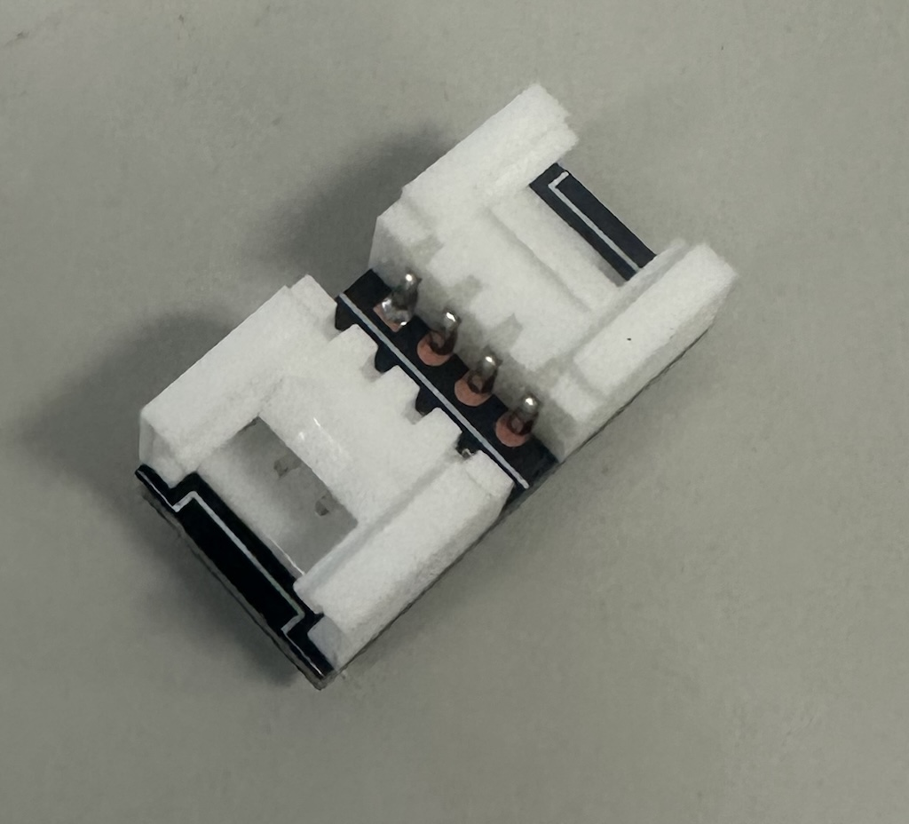
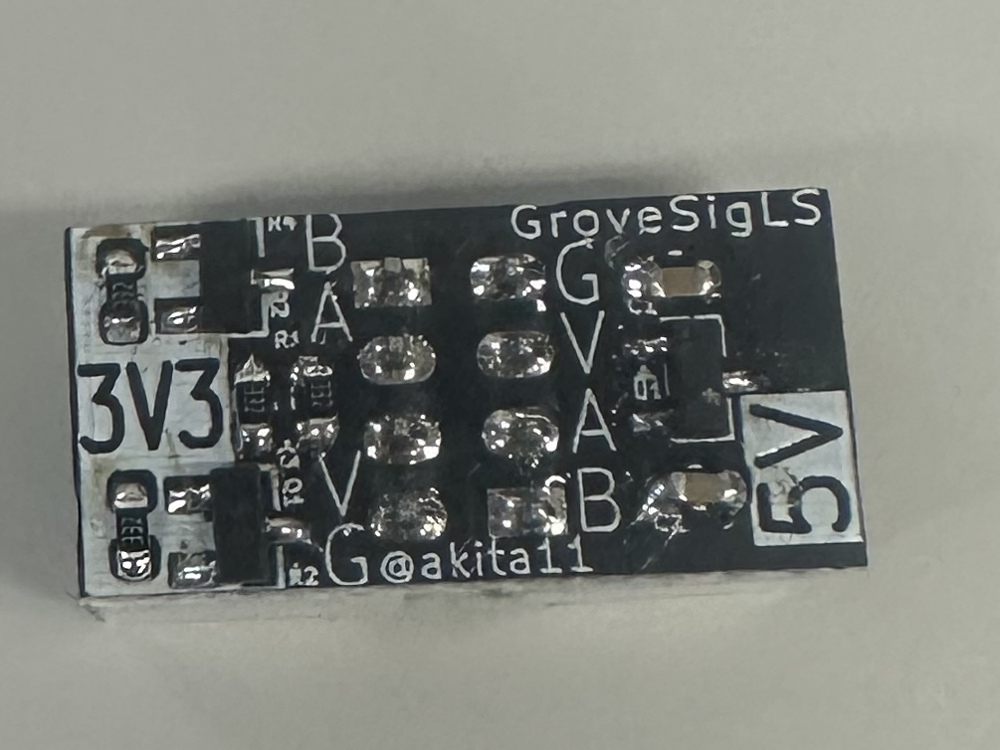

# Grove Signal Level Shifter

Grove端子の2本の信号線の信号電圧を、5V/3.3Vで相互に変換します。例えば信号電圧が3.3VのM5Stackシリーズで5V系のI2CデバイスやUART通信を行うことができます。

電源が5V、信号が3.3Vの「Groveコネクタ」（M5Stackシリーズなど）を、5V系のGroveから使用することができます。
電源は5V系から与えてください。

## 使い方

- 基板裏面「5V」と書かれたら側のGroveコネクタに5V系のGroveケーブルを接続します。
- 基板裏面「3V3」と書かれたら側のGroveコネクタに3.3V系のGroveケーブルを接続します。
  - こちら側のGroveコネクタの電源は、「5V」側のものがそのまま接続されています。3.3Vに降圧されませんので注意してください。

## Author

Junichi Akita (@akita11) / akita@ifdl.jp

